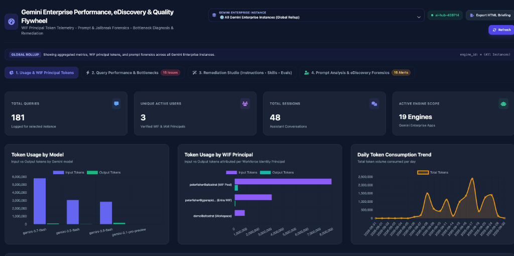
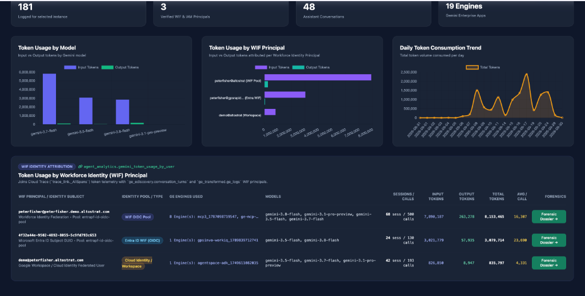
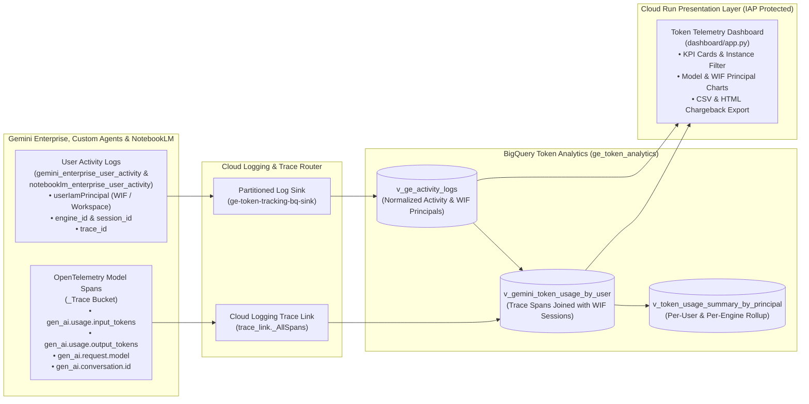

# Gemini Enterprise Token Consumption & Workforce Identity (WIF) Usage Telemetry

> **Disclaimer**: This repository and its contents are provided for illustration and educational purposes only as example code. This is not an official Google product or officially supported Google Cloud project. This code is provided as-is for demonstration purposes and is NOT intended or supported for production workloads. The views, code, and opinions expressed in this repository are those of the author(s) and do not necessarily reflect the position, opinions, or official policy of Google LLC or Google Cloud Platform.

---

## Overview

Higher-education institutions, public-sector agencies, and enterprises deploying **Gemini Enterprise** (Google Cloud Discovery Engine) and **NotebookLM Enterprise** with **Workforce Identity Federation (WIF)** (such as Microsoft Entra ID, Okta, or Ping Identity) or **Google Workspace / Cloud Identity** frequently need a lightweight, turnkey way to **track token consumption, model usage, and active user sessions** without deploying complex eDiscovery archival infrastructure.

This project provides a streamlined, zero-KMS, zero-Cloud-Storage token tracking and usage metrics pipeline derived from [`ge-ediscovery-logging`](../ge-ediscovery-logging), focused exclusively on **real-time BigQuery token telemetry and the Gemini Enterprise Token Consumption Dashboard**:

1. **Automated Engine, Agent & NotebookLM Observability Enablement (`enable_ge_observability.py`)**:
   - Enables `observabilityEnabled=true` across all Gemini Enterprise apps/engines (`global`, `us`, `eu`), custom Agents (`lowCodeAgentDefinition`, `adkAgentDefinition`, `a2aAgentDefinition`), and Project-level NotebookLM Enterprise (`customerProvidedConfig.notebooklmConfig.observabilityConfig`).
   - Supports **Token/Metadata-Only Mode (`--no-sensitive-logging`)** for higher-education (FERPA) or privacy-sensitive environments that want full per-user and per-model token attribution **without** logging raw user prompts or model responses.
2. **Lightweight Cloud Logging + Cloud Trace (`_Trace`) BigQuery Pipeline (`setup_bigquery_token_tracking.py`)**:
   - Creates a single partitioned Cloud Logging sink (`ge-token-tracking-bq-sink`) streaming `discoveryengine.googleapis.com/gemini_enterprise_user_activity` and `discoveryengine.googleapis.com/notebooklm_enterprise_user_activity` into BigQuery (`ge_token_analytics`).
   - Links the Cloud Trace `_Trace` bucket directly to BigQuery (`trace_link._AllSpans`) via `gcloud logging links create`.
   - Deploys three pre-built BigQuery analytical views (`v_ge_activity_logs`, `v_gemini_token_usage_by_user`, and `v_token_usage_summary_by_principal`) that join OpenTelemetry model execution spans (`gen_ai.usage.input_tokens`, `gen_ai.usage.output_tokens`, `gen_ai.request.model`, `gen_ai.conversation.id`) with WIF user principals (`userIamPrincipal`) and Gemini Enterprise instances (`engine_id`).
3. **Focused Cloud Run Token Consumption & WIF Usage Dashboard (`dashboard/`, `deploy_dashboard.py`)**:
   - **Instance Selector Dropdown**: View a **Global Rollup (`ALL`)** across all Gemini Enterprise and NotebookLM instances, or filter metrics down to a single `engine_id`.
   - **4 Executive KPI Cards**: **Total Queries**, **Unique Active Users** (verified WIF & IAM principals), **Total Sessions**, and **Active Engine Scope**.
   - **3 Interactive Chart.js Visualizations**:
     - **Token Usage by Model** (`Input Tokens` vs. `Output Tokens` across `gemini-3.8-flash`, `gemini-3.7-flash`, `gemini-3.5-flash`, `gemini-3.1-pro-preview`, etc.)
     - **Token Usage by WIF Principal** (`Input Tokens` vs. `Output Tokens` attributed per Workforce Identity Principal or Workspace user)
     - **Daily Token Consumption Trend** (Daily token volume over time)
   - **WIF Identity Attribution Table (`v_gemini_token_usage_by_user`)**: Per-user breakdown of Identity Pool/Type (`WIF OIDC Pool`, `Entra ID WIF (OIDC)`, `Cloud Identity / Workspace`), GE Engines Used, Models, Sessions/Calls, Input Tokens, Output Tokens, Total Tokens, and Average Tokens per Call, plus **1-click CSV Export** (`/api/export-csv`) and **Printable HTML Briefing Export** (`/api/export-html`).

---

## Dashboard Preview

### Global Rollup, KPI Summary Cards & Token Consumption Charts


### Per-User Workforce Identity (WIF) Principal Token Attribution Table


---

## Architecture Flow



### How Token Attribution Works

When a user sends a prompt in Gemini Enterprise (or invokes a custom No-Code / ADK agent):
1. **Cloud Trace (`trace_link._AllSpans`)** records a `generate_content` OpenTelemetry span containing:
   - `trace_id`
   - `attributes['gen_ai.conversation.id']` (formatted as `projects/.../locations/.../collections/default_collection/engines/{engine_id}/sessions/{session_id}`)
   - `attributes['gen_ai.request.model']` (e.g., `gemini-3.8-flash`, `gemini-3.7-flash`, `gemini-3.5-flash`, `gemini-3.1-pro-preview`)
   - `attributes['gen_ai.usage.input_tokens']` and `attributes['gen_ai.usage.output_tokens']`
2. **Cloud Logging (`gemini_enterprise_user_activity`)** records the `StreamAssist` / `Assist` event containing:
   - `trace` (matching the span's `trace_id`)
   - `jsonPayload.userIamPrincipal` (the user's Workforce Identity Federation principal `principal://iam.googleapis.com/locations/global/workforcePools/<POOL>/subject/<SUBJECT>` or Google Workspace email)
   - `session_id` and `engine_id`
3. **BigQuery (`v_gemini_token_usage_by_user`)** joins `trace_link._AllSpans` with `v_ge_activity_logs` on `trace_id` and `session_id`, attributing every input and output token to the exact WIF principal, Gemini model, and Gemini Enterprise engine.

---

## Quick Start (3 Steps)

### Prerequisites
- Google Cloud SDK (`gcloud` and `bq`) authenticated with permissions to manage Discovery Engine observability, Cloud Logging sinks/links, BigQuery datasets, and Cloud Run.
- Set your Google Cloud Project ID:
  ```bash
  export GCP_PROJECT_ID="your-gcp-project-id"
  gcloud config set project "${GCP_PROJECT_ID}"
  ```

### Step 1: Enable Observability on Gemini Enterprise Engines, Agents & NotebookLM

Run `enable_ge_observability.py` to enable OpenTelemetry trace emission (`observabilityEnabled=true`) across all Gemini Enterprise apps, custom agents, and NotebookLM Enterprise:

```bash
# Standard mode (enables OpenTelemetry traces + prompt/response logging):
python3 enable_ge_observability.py --project-id="${GCP_PROJECT_ID}"

# Optional privacy/FERPA mode (enables OpenTelemetry token traces & WIF user activity WITHOUT prompt/response text):
python3 enable_ge_observability.py --project-id="${GCP_PROJECT_ID}" --no-sensitive-logging
```

### Step 2: Provision BigQuery Sink, Cloud Trace Link & Token Views

Run `setup_bigquery_token_tracking.py` to create the `ge_token_analytics` BigQuery dataset, the `ge-token-tracking-bq-sink` Cloud Logging sink, the `trace_link` (`_AllSpans`) linked dataset, and the SQL views:

```bash
python3 setup_bigquery_token_tracking.py --project-id="${GCP_PROJECT_ID}"
```

### Step 3: Run the Dashboard Locally or Deploy to Cloud Run

#### Option A: Run Locally
```bash
cd dashboard
pip install -r requirements.txt

export GCP_PROJECT_ID="your-gcp-project-id"
python3 app.py
```
Open **`http://127.0.0.1:8080`** in your browser.

#### Option B: Deploy to Cloud Run (with Least-Privilege SA & IAP)
```bash
python3 deploy_dashboard.py \
  --project-id="${GCP_PROJECT_ID}" \
  --region="us-central1" \
  --service-name="ge-token-tracking-dashboard" \
  --iap
```
`deploy_dashboard.py` automatically creates a dedicated read-only service account (`ge-token-dashboard-sa@<PROJECT_ID>.iam.gserviceaccount.com`) with **only** `roles/bigquery.dataViewer` and `roles/bigquery.jobUser`, and deploys the container with `--no-allow-unauthenticated` and Identity-Aware Proxy (`--iap`).

---

## Sample BigQuery Queries for FinOps & Chargeback

### 1. Token Consumption by Workforce Identity (WIF) Principal
```sql
SELECT
  user_principal,
  total_sessions,
  llm_calls,
  engines_used,
  engine_list,
  models_used,
  input_tokens,
  output_tokens,
  total_tokens,
  avg_tokens_per_call
FROM `<YOUR_GCP_PROJECT_ID>.ge_token_analytics.v_token_usage_summary_by_principal`
ORDER BY total_tokens DESC;
```

### 2. Daily Token Consumption by Model and Engine Instance
```sql
SELECT
  FORMAT_DATE('%Y-%m-%d', DATE(start_time)) AS usage_date,
  engine_id,
  model,
  COUNT(*) AS model_invocations,
  SUM(input_tokens) AS input_tokens,
  SUM(output_tokens) AS output_tokens,
  SUM(total_tokens) AS total_tokens
FROM `<YOUR_GCP_PROJECT_ID>.ge_token_analytics.v_gemini_token_usage_by_user`
WHERE start_time IS NOT NULL
GROUP BY usage_date, engine_id, model
ORDER BY usage_date DESC, total_tokens DESC;
```

---

## Running Automated Tests

```bash
cd dashboard
pytest test_app.py -v
```

---

## Comparison: `ge-token-tracking` vs. `ge-ediscovery-logging`

| Capability | `ge-token-tracking` (This Folder) | [`ge-ediscovery-logging`](../ge-ediscovery-logging) |
| :--- | :--- | :--- |
| **Primary Use Case** | Token consumption tracking, WIF user attribution, model usage analytics & FinOps chargeback | Full legal eDiscovery, cryptographic file archival, spoliation prevention & Microsoft Purview integration |
| **Token Usage by Model & WIF Principal** | Yes (`trace_link._AllSpans` + `v_gemini_token_usage_by_user`) | Activity & forensic turn logging |
| **Token-Only Privacy Mode (`--no-sensitive-logging`)** | Yes | Requires `sensitiveLoggingEnabled=true` |
| **Infrastructure Footprint** | BigQuery + Cloud Logging Sink + `_Trace` Link + Cloud Run Dashboard | Adds Cloud KMS Asymmetric Key, WIF OIDC Archiver Provider, Pub/Sub Harvester, GCS WORM Bucket, `geUserNoDelete` IAM Role & Purview Connector |
